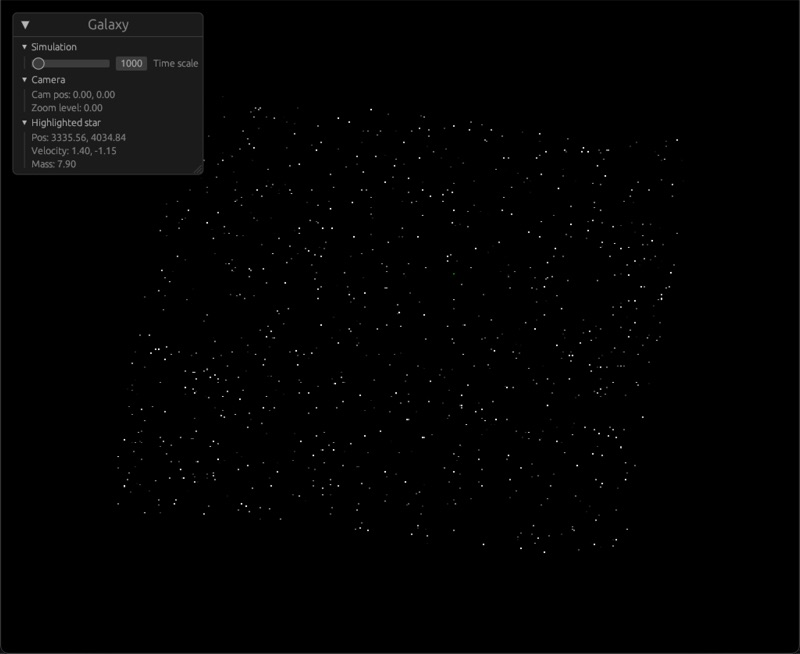
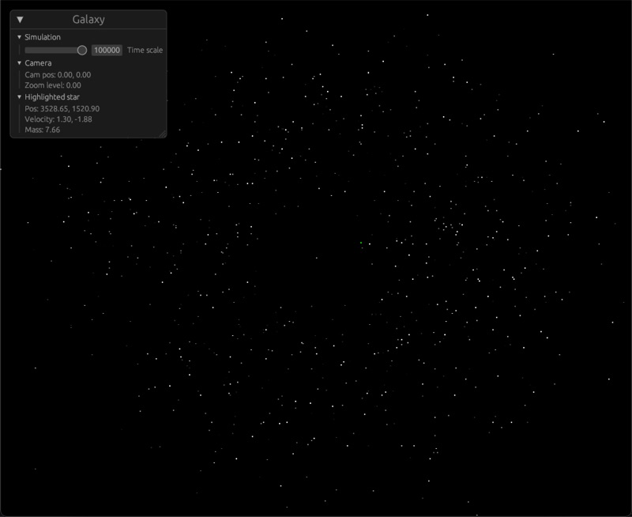
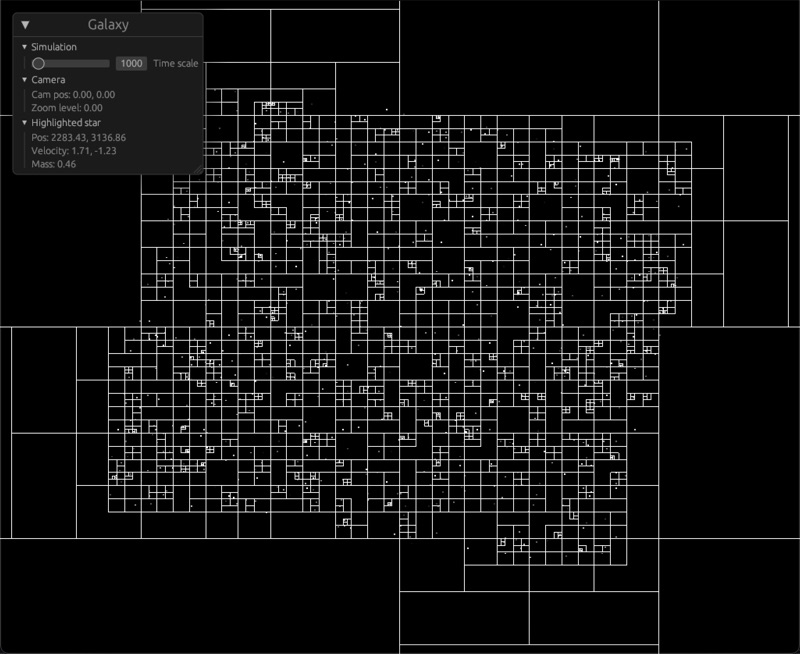

# Galaxy

A simple (and a bit messy) galaxy and gravity simulator in Rust. It scatters a thousand
stars around a supermassive black hole and lets gravity do its thing.

To keep it fast it uses a Barnes-Hut quadtree, so stars only work out the pull of nearby
stars individually and treat far away groups of stars as one big mass. The quadtree is
stored sparsely using Hilbert curve indexes, and you can see it in the last screenshot by
turning on `DEBUG_DRAW_QUADTREE` in `src/galaxy.rs`.

## Getting it running

You'll need Rust, then just `cargo run`.

Dev builds are optimised since the simulation is far too slow without it, so you only
need `--release` if you want a lot more stars (change `STAR_COUNT` in `src/galaxy.rs`).
Run it with `RUST_LOG=debug` to see how long each step takes.

## Controls

Drag with the left mouse button to move around and scroll to zoom. Hover over a star to
see its position, velocity and mass, and right click to lock the camera onto it (right
click again to let go).

Space makes a new galaxy, M and A speed time up and slow it down, and Escape quits.
